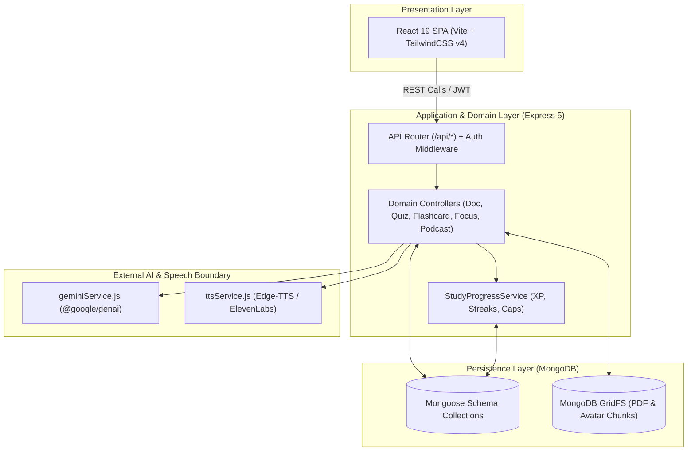

# Software Design & Architecture: CleverPrep

**Project:** CleverPrep — AI-Powered Personalized Learning & Exam Preparation Platform  
**Academic Program:** M.Sc. (IT), Dhirubhai Ambani University  
**Project Guide:** Prof. Shruti Bhilare

---

## 1. System Architecture Overview

CleverPrep follows a decoupled client-server architecture separating presentation, API routing, domain business logic, data persistence, and third-party AI/TTS providers.



---

## 2. Five Product Rules Enforced in Code

### Rule 1: Daily Streak XP Threshold ($\ge 50$ XP)

- **Explanation:** To earn or increment a consecutive daily study streak, a student must accumulate at least **50 XP** in their local calendar day.
- **Why It Exists:** Ensures students engage in meaningful study effort (e.g. reviewing 50 cards or studying 25 minutes) rather than superficial daily logins.
- **Implementation:** [backend/services/studyProgressService.js:114](backend/services/studyProgressService.js#L114) and [backend/config/gamification.js:2](backend/config/gamification.js#L2).
  ```javascript
  const todaySessions = await StudySession.find({ userId, localDate });
  const todayTotalPoints = todaySessions.reduce(
    (acc, curr) => acc + curr.pointsEarned,
    0,
  );
  if (todayTotalPoints >= STUDY_CONFIG.DAILY_STREAK_THRESHOLD) {
    /* advance streak */
  }
  ```
- **Violation Behavior:** If a user earns $< 50$ XP in a day, streak is not incremented. Missing a day resets `currentStreak` to 1.

### Rule 2: Focus Session Daily XP Cap (500 XP Anti-Farming)

- **Explanation:** A student can earn at most **500 XP per calendar day** from Pomodoro focus sessions (2 XP/min, max 250 minutes).
- **Why It Exists:** Prevents leaderboard and level farming from unattended timers running in background tabs.
- **Implementation:** [backend/services/studyProgressService.js:76-79](backend/services/studyProgressService.js#L76-L79) and [backend/config/gamification.js:3](backend/config/gamification.js#L3).
  ```javascript
  if (todayFocusPoints + pointsEarned > STUDY_CONFIG.MAX_FOCUS_XP_PER_DAY) {
    pointsEarned = Math.max(
      0,
      STUDY_CONFIG.MAX_FOCUS_XP_PER_DAY - todayFocusPoints,
    );
  }
  ```
- **Violation Behavior:** Session duration is recorded for analytics, but awarded XP is clamped to the remaining allowance or 0 once 500 XP is reached.

### Rule 3: Study Activity Idempotency & Duplicate Prevention

- **Explanation:** Repeated submissions of the same activity event must not credit XP or advance streaks multiple times.
- **Why It Exists:** Prevents duplicate XP awards from flaky network retries or client offline-queue re-transmissions.
- **Implementation:** [backend/services/studyProgressService.js:52-65](backend/services/studyProgressService.js#L52-L65) and [backend/models/StudySession.js:48-52](backend/models/StudySession.js#L48-L52) (`sparse: true, unique: true`).
  ```javascript
  if (idempotencyKey) {
    const existingSession = await StudySession.findOne({
      userId,
      idempotencyKey,
    });
    if (existingSession)
      return { session: existingSession, xpEarned: 0, todayXP: 0 };
  }
  ```
- **Violation Behavior:** Returns the cached session with `xpEarned: 0` and HTTP 200 without increasing user XP.

### Rule 4: Quiz Resubmission Lock & Retake

- **Explanation:** Once a quiz is submitted and graded, it cannot be submitted again without an explicit reset.
- **Why It Exists:** Prevents answer tampering where a student inspects correct answers in results and resubmits for 100% score.
- **Implementation:** [backend/controllers/quizController.js:90-97](backend/controllers/quizController.js#L90-L97) and reset endpoint at [backend/controllers/quizController.js:280-307](backend/controllers/quizController.js#L280-L307).
  ```javascript
  if (quiz.completedAt) {
    return res.status(400).json({
      success: false,
      error: "Quiz already completed",
      statusCode: 400,
    });
  }
  ```
- **Violation Behavior:** Rejects submission with HTTP 400 (`"Quiz already completed"`). User must call `POST /api/quizzes/:id/retake` to reset `completedAt: null`.

### Rule 5: Mandatory Email Verification for Credential Login

- **Explanation:** Email/password accounts must verify their email via OTP before receiving an authenticated JWT.
- **Why It Exists:** Prevents unverified accounts from consuming external API resources (Gemini and TTS).
- **Implementation:** [backend/controllers/authController.js:222-231](backend/controllers/authController.js#L222-L231).
  ```javascript
  const isVerified = Boolean(user.isEmailVerified || user.emailVerified);
  if (!isVerified) {
    return res.status(400).json({
      success: false,
      error: "Please verify your email before signing in.",
      statusCode: 400,
      notVerified: true,
    });
  }
  ```
- **Violation Behavior:** Returns HTTP 400 (`notVerified: true`). Login page redirects to `/verify-email`.

---

## 3. Three Real Design Decisions

### Decision 1: MongoDB GridFS for Binary Document & Media Persistence

- **Problem Solved:** Academic PDFs and generated podcast audio cannot reside on local container filesystems (ephemeral disks wiped on Docker/Render restart), and raw binary buffers exceed MongoDB's 16 MB BSON document limit.
- **Named Principle:** **Separation of Concerns & Infrastructure Decoupling.**
- **Code Locations:** [backend/utils/gridfs.js:25-51](backend/utils/gridfs.js#L25-L51), [backend/controllers/documentController.js:43-55](backend/controllers/documentController.js#L43-L55).
- **Before / Alternative Design:** Local disk file storage in `uploads/` (`app.use('/uploads')` in [backend/server.js:62](backend/server.js#L62)).
- **Why New Approach Is Better:** Chunks binaries into 255 KB blocks inside MongoDB (`documents.files` and `documents.chunks`), providing self-contained, cloud-portable storage without an external AWS S3 dependency.
- **Historical Note:** _Prior local-disk controller commit history is unverified in Git; inferred from legacy `uploads/` directory artifacts._

### Decision 2: Timezone-Aware Daily Streak & XP Evaluation

- **Problem Solved:** Evaluating daily streak cutoffs at UTC midnight causes mid-session streak breaks for international students (e.g. at 5:30 AM in India, UTC+5:30).
- **Named Principle:** **Domain-Driven Single Responsibility Principle (SRP).**
- **Code Locations:** [frontend/src/utils/axiosInstance.js:37](frontend/src/utils/axiosInstance.js#L37), [backend/middleware/auth.js:25-33](backend/middleware/auth.js#L25-L33), [backend/services/studyProgressService.js:9-16](backend/services/studyProgressService.js#L9-L16).
- **Before / Alternative Design:** Single root UTC timestamp `lastStudyDate` evaluated at server midnight (evidenced in [backend/scripts/migrateStreaks.js:1-55](backend/scripts/migrateStreaks.js#L1-L55)).
- **Why New Approach Is Better:** Client passes `X-Timezone` header (`Intl.DateTimeFormat().resolvedOptions().timeZone`); backend evaluates calendar days via `Intl.DateTimeFormat('en-CA', { timeZone })`, ensuring midnight transitions match the student's physical location.
- **Historical Note:** _Pre-refactor state is verified via migration script artifacts; earlier Git commit history is unverified._

### Decision 3: Centralized Study Progress Service (Single Source of Truth)

- **Problem Solved:** Multiple subsystems award XP (document upload, flashcards, quizzes, focus sessions, podcasts). Duplicating streak and XP formulas across multiple controllers causes code duplication and mathematical inconsistencies.
- **Named Principle:** **Single Responsibility Principle (SRP) & Don't Repeat Yourself (DRY).**
- **Code Locations:** [backend/services/studyProgressService.js:46-163](backend/services/studyProgressService.js#L46-L163), [backend/config/gamification.js:1-28](backend/config/gamification.js#L1-L28).
  Invoked from: [documentController.js:63-70](backend/controllers/documentController.js#L63-L70), [quizController.js:161-168](backend/controllers/quizController.js#L161-L168), [flashcardController.js:201-208](backend/controllers/flashcardController.js#L201-L208), [focusController.js:256-266](backend/controllers/focusController.js#L256-L266).
- **Before / Alternative Design:** Decentralized business logic embedded across individual controller routes.
- **Why New Approach Is Better:** Consolidates level formulas, streak evaluations, daily caps, and idempotency checks into one auditable service.
- **Historical Note:** _An intentional architectural design pattern rather than a documented historical Git refactor._

---

## 4. Architectural Boundary

```
[Domain Controllers & Services]
  (documentController, quizController, podcastController, studyProgressService)
             │
             │  Clean Domain Objects & Strict JSON Schemas
             ▼
┌────────────────────────────────────────────────────────┐
│             ARCHITECTURAL BOUNDARY ADAPTERS            │
│  backend/utils/geminiService.js                        │
│  backend/utils/ttsService.js                           │
└────────────────────────────────────────────────────────┘
             │
             │  Vendor SDK Calls (@google/genai, node-edge-tts, FFmpeg)
             ▼
[External AI Providers & Binaries]
```

- **Protected Dependency:** Core controllers never import `@google/genai` or speech synthesis SDKs directly. All prompt templates, JSON schema validation, and audio stitching are isolated inside [backend/utils/geminiService.js](backend/utils/geminiService.js) and [backend/utils/ttsService.js](backend/utils/ttsService.js). Vendor API changes do not pollute domain controllers.
- **Documented Boundary Exception:** [backend/controllers/podcastController.js:251-268](backend/controllers/podcastController.js#L251-L268) directly checks `fs.existsSync` and uses `fs.createReadStream` to stream audio from `uploads/podcasts/` rather than delegating streaming to a dedicated storage abstraction.

---

## 5. AI Development Tools

1. **Google Gemini 2.0 / 1.5 Flash (`@google/genai`):** Runtime AI engine for generating flashcards, 4-option quizzes, document summaries, and podcast dialogue scripts.
2. **ChatGPT (OpenAI) & Antigravity IDE (Google DeepMind):** Development-time AI assistants used for initial boilerplate generation, React component scaffolding, and documentation drafting.
3. **Engineering Governance:** All AI-assisted code was manually reviewed, refactored, and verified against project architecture. No AI code was accepted without human review.

---

## 6. Rejected AI Suggestion: AI Plagiarism Detection Feature

- **AI Suggestion:** Add an AI-powered plagiarism detection feature allowing students to upload assignments and check for copied external text.
- **Reason for Rejection:** CleverPrep's primary domain purpose is personalized active self-study, exam revision, and conceptual mastery—not assignment policing or submission grading. Plagiarism checking would require external web crawler databases and massive server processing outside project scope.
- **Our Decision:** Prioritized core generative study aids: 4-option quizzes, active recall flashcards, grounded document Q&A, and dual-speaker audio podcasts.
- **Design Principle Applied:** **Scope Management and Separation of Concerns (SoC).**
- **Architectural Outcome:** Preserves high architectural cohesion, remaining focused on self-paced study.
