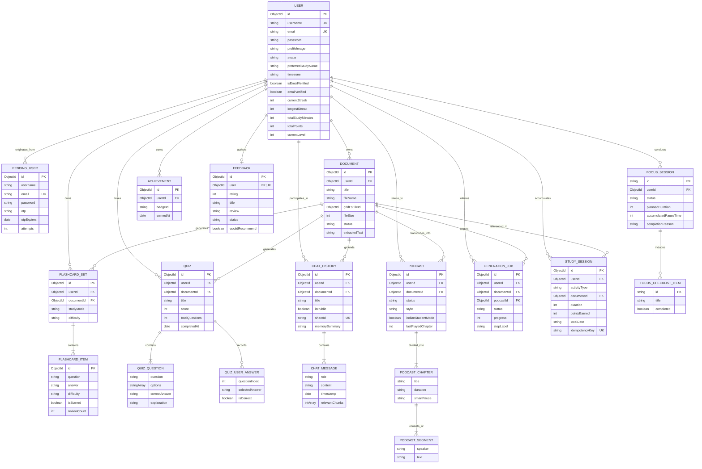

# Ubiquitous Language: CleverPrep

**Project:** CleverPrep — AI-Powered Personalized Learning & Exam Preparation Platform
---

### Project & Team Details

| Team Member | Student ID / Role |
| :--- | :---: |
| **Varunee Agrawal** | `202512048` (Lead Developer) |
| **Jayraj Dhadhal** | `202512043` (Full-Stack Engineer) |
| **Dhirubhai Ambani University M.Sc. (IT)** | Project Batch 2024–2026 |
| **Prof. Shruti Bhilare** | Faculty Project Guide |

- **Architecture:** Client-Server Monolithic API with Background Workers (React 19 / Vite / Tailwind CSS Frontend, Node.js / Express.js Backend, MongoDB with GridFS Storage, Google Gemini & OpenAI LLMs, Edge-TTS Audio Generation)
- **Document Purpose:** Canonical reference for domain terms, entity models, user roles, business rules, system workflows, and ubiquitous language across the CleverPrep platform.

---

## Table of Contents

- [A. Project Overview](#a-project-overview)
- [B. Core Domain Concepts](#b-core-domain-concepts)
- [C. Ubiquitous Language Glossary](#c-ubiquitous-language-glossary)
- [D. Actors and Their Responsibilities](#d-actors-and-their-responsibilities)
- [E. Business Processes and Workflows](#e-business-processes-and-workflows)
- [F. Business Rules and Constraints](#f-business-rules-and-constraints)
- [G. Domain Relationships and ER Diagram](#g-domain-relationships-and-er-diagram)
- [H. Domain Events and State Transitions](#h-domain-events-and-state-transitions)
- [I. Naming Conventions](#i-naming-conventions)
- [J. Flagged Terminology Ambiguities](#j-flagged-terminology-ambiguities)
- [K. Implementation Gaps and Open Questions](#k-implementation-gaps-and-open-questions)

---

## A. Project Overview

**CleverPrep** is an intelligent, self-paced learning and exam preparation platform. Traditional academic preparation requires students to expend extensive cognitive energy manually reading hundred-page PDF textbooks, extracting summaries, writing flashcards, creating practice exam questions, and organizing study intervals. This passive study workflow results in cognitive fatigue, low long-term retention, and disorganized preparation.

CleverPrep solves this challenge by serving as an autonomous AI study partner. Learners upload their course materials (lecture notes, syllabi, PDF slide decks, textbooks), and the platform's multi-stage AI pipeline automatically converts the raw text into:
1. **Executive Summaries & Concept Breakdowns:** High-yield distilled knowledge.
2. **Interactive Flashcards:** Spaced-repetition study decks with memory tips and difficulty tagging.
3. **Adaptive Practice Quizzes:** 4-option multiple-choice evaluations with history-aware deduplication and Fisher-Yates chunk sampling.
4. **Contextual Document Chat (RAG):** Retrieval-Augmented Generation for grounded question answering with background conversation memory compression.
5. **Multi-Speaker Audio Podcasts:** Conversational teacher-and-student audio episodes featuring Hinglish/Indian student analogies, smart pauses, and chapter-based playback.
6. **Deep Work Focus Workspace:** A Pomodoro-style productivity suite with ambient soundscapes, heartbeat synchronization, and time-tracked checklists.
7. **Gamification & Habit Engine:** Localized daily study streaks, Level progression, XP thresholds, and a 52-week GitHub-style contribution calendar.

### Platform Architecture & Tech Stack

CleverPrep operates on a decoupled client-server architecture hosted across cloud environments (Render, MongoDB Atlas):

- **Client Application Layer (`frontend`):** Built on **React 19** initialized via **Vite**, styled using **Tailwind CSS v4**, animated with **Framer Motion**, and visualized with **Recharts**. Client routing is managed via **React Router DOM v7**.
- **Application & API Gateway Layer (`backend`):** Built with **Node.js** and **Express.js (v5)**, featuring JWT stateless token authentication, bcrypt password hashing, input validation via `express-validator`, and denial-of-service/API rate-limiting via `express-rate-limit`.
- **Large Language Model (LLM) Engine:** Dual-engine architecture utilizing **Google Gemini** (`@google/genai`) for multi-turn contextual RAG chat, flashcard generation, quiz generation, and podcast script synthesis, with **OpenAI** (`openai`) prompt engineering pipelines.
- **Audio Generation Pipeline:** Uses `node-edge-tts` and **ElevenLabs** for speech synthesis, combined with `fluent-ffmpeg` and `@ffmpeg-installer/ffmpeg` background workers to stitch audio segments, chapters, and background music into streamable audio.
- **Data Persistence Layer:** **MongoDB** modeled via **Mongoose**. Large PDF files and user avatar binaries are streamed into **MongoDB GridFS** (`documents.files` and `documents.chunks`), preventing file system bloat and ensuring atomic document management.

---

## B. Core Domain Concepts

Concepts are categorized and tagged as **[Implemented]** (existing in current code) or **[Proposed]** (planned future additions).

### 1. Document Processing & Ingestion

- **Document [Implemented]:** A primary learning resource uploaded by a user (typically a PDF). Represented by `Document` (`models/Document.js`), containing title, file size, content type, upload timestamp, and processing status.
- **GridFS File Storage [Implemented]:** Document binaries are stored directly in MongoDB GridFS buckets (`gridFsFileId`), bypassing server disk limits and enabling scalable file streaming.
- **Text Chunk [Implemented]:** A segmented block of extracted text (approx. 500–1000 characters). Each chunk retains its page number and sequential `chunkIndex` to facilitate pinpoint contextual retrieval during AI chat and quiz generation.
- **Document Status [Implemented]:** State machine tracking document ingestion: `processing` $\rightarrow$ `ready` (or `failed`).

### 2. Generative Learning Artifacts

- **Summary [Implemented]:** An AI-generated distillation of the document's core principles, formulas, and takeaways rendered in styled Markdown.
- **Flashcard Set [Implemented]:** A cohesive collection of revision cards generated for a specific document, stored in `models/Flashcard.js`. Includes generation settings (`studyMode`, `flashcardCount`, `difficulty`) and learning insights (`complexity`, `estimatedTime`, `recommendedStrategy`).
- **Card (Flashcard Item) [Implemented]:** A single question-and-answer prompt with supplementary `explanation`, `memoryTip`, difficulty rating (`easy`, `medium`, `hard`), `reviewCount`, `lastReviewed` timestamp, and a favorite `isStarred` toggle.
- **Quiz [Implemented]:** An interactive assessment tied to a document, stored in `models/Quize.js`. Consists of multiple-choice questions, user answers, final percentage score, and completion timestamp.
- **Question [Implemented]:** A multiple-choice prompt requiring exactly 4 distinct options, one designated `correctAnswer`, and an accompanying educational explanation.
- **User Answer [Implemented]:** A learner's response to a quiz question, recording the `questionIndex`, `selectedAnswer`, evaluation boolean `isCorrect`, and `answeredAt` timestamp.

### 3. Conversational AI & Context Memory

- **Chat History (Conversation) [Implemented]:** A multi-turn dialogue thread between the learner and the AI tutor grounded in a specific document (`models/ChatHistory.js`). Contains an array of messages and an optional `shareId`.
- **Message [Implemented]:** An atomic interaction in a conversation having a `role` (`user` or `assistant`), text content, timestamp, and an array of `relevantChunks` that provided grounding.
- **Memory Summary [Implemented]:** A compressed background summary generated every 20 messages to keep the LLM context window concise without losing historical context.
- **Shared Conversation [Implemented]:** A publicly accessible read-only snapshot of a chat conversation accessible via a unique UUID (`shareId`).
- **Concept Explainer [Implemented]:** An on-demand semantic lookup where the learner queries a difficult term, and the system synthesizes an explanation grounded in the document's chunks.

### 4. Audio Lessons & AI Podcasts

- **Podcast [Implemented]:** An AI-generated, multi-speaker educational audio episode (`models/Podcast.js`) translating document material into an engaging dialogue between a teacher and a student.
- **Generation Job [Implemented]:** An asynchronous background task (`models/GenerationJob.js`) tracking podcast synthesis through stages: `pending` $\rightarrow$ `processing` $\rightarrow$ `retrying` $\rightarrow$ `completed` (or `failed`).
- **Chapter [Implemented]:** A structured topic segment within a podcast episode with its own audio track, duration, and list of dialogue segments.
- **Segment [Implemented]:** A single conversational dialogue line spoken by either the `teacher` or `student` voice.
- **Smart Pause [Implemented]:** An interactive audio checkpoint embedded in a podcast chapter that prompts the learner to pause playback and explain a concept out loud.
- **Exam Booster [Implemented]:** High-yield chapter metadata providing key definitions, frequently asked exam questions, memory tricks, and common student mistakes.
- **Indian Student Mode [Implemented]:** An audio customization mode tailoring the dialogue script with Hinglish terminology, local cultural analogies, and Indian exam contexts.
- **Audio Bookmark [Implemented]:** A user-created playback marker saving a specific timestamp, chapter index, and personal study note.

### 5. Focus Workspace & Deep Work

- **Focus Session [Implemented]:** A live, stateful Pomodoro work block (`models/FocusSession.js`) managing active work, pause intervals, heartbeats, and embedded task checklists.
- **Focus Status [Implemented]:** The live state of a focus timer: `running` $\longleftrightarrow$ `paused` $\rightarrow$ `completed` (or `abandoned`, `failed`).
- **Focus Checklist [Implemented]:** A micro-task list embedded inside a focus session to keep the student focused on discrete goals during deep work.
- **Ambient Sound [Implemented]:** Background soundscapes (e.g., Rain, Cafe, White Noise, Campfire) managed by the client `AmbientAudioManager` to enhance concentration.

### 6. Gamification, Habits & Analytics

- **Study Session [Implemented]:** An immutable historical audit log (`models/StudySession.js`) created whenever an educational action is completed (e.g., uploading a document, reviewing cards, completing a quiz, listening to a podcast, running a focus timer).
- **Activity Type [Implemented]:** One of seven tracked learning events: `upload_document`, `read_notes`, `flashcard_review`, `quiz_completed`, `podcast_listening`, `focus_session`, or `ai_chat`.
- **Experience Points (XP / Points) [Implemented]:** Quantified effort points awarded per activity based on formulaic weights configured in `config/gamification.js`.
- **Study Streak [Implemented]:** The consecutive count of days on which a learner earns at least 50 XP (`DAILY_STREAK_THRESHOLD`), evaluated in the learner's localized timezone.
- **Gamification Level [Implemented]:** An exponential level index calculated dynamically from cumulative XP: $\text{Level} = \lfloor\sqrt{\text{Total XP} / 100}\rfloor + 1$.
- **Contribution Heatmap [Implemented]:** A 52-week calendar visualization depicting daily study intensity across 4 quantiles based on minutes studied and XP earned.
- **Achievement / Badge [Implemented / Partial]:** Milestone awards stored in `models/Achievement.js` linking a `userId` to a `badgeId`.

### 7. Identity, Onboarding & Community Feedback

- **User Profile [Implemented]:** Authenticated account stored in `models/User.js`, maintaining credentials, avatars, localized timezone, study statistics, and tour onboarding state.
- **Pending User [Implemented]:** A temporary staging document (`models/PendingUser.js`) storing unverified account credentials and a 6-digit OTP with a 10-minute time-to-live (TTL).
- **Preferred Study Name [Implemented]:** A customized study name used by the AI podcast engine to address the student conversationally during audio lectures.
- **Guided Product Tour [Implemented]:** An interactive step-by-step UI onboarding overlay highlighting key navigation items and workspaces for first-time users.
- **Community Feedback [Implemented]:** A user review and rating (1 to 5 stars) stored in `models/Feedback.js` with verified study statistics and automated spam/profanity moderation.

### 8. Advanced / Proposed Concepts

- **Spaced Repetition Engine (SM-2 / Leitner) [Proposed]:** Algorithm calculating optimal review intervals based on card ratings (`Again`, `Good`, `Easy`).
- **Live Voice Tutor (Speech-to-Speech) [Proposed]:** Real-time conversational audio tutoring using the Gemini Live API.
- **Collaborative Study Groups [Proposed]:** Shared document workspaces and group quiz challenges for university batches.

---

## C. Ubiquitous Language Glossary

| Term | Definition | Aliases to avoid | Named in code at |
|---|---|---|---|
| **Document** | An uploaded academic file (PDF) containing course material, processed into text chunks and persisted in GridFS. | File, Courseware, PDF, Paper, Slide Deck | Model `Document` in `backend/models/Document.js`, DB collection `/documents`, `documentController.js`, `DocumentCard.jsx` |
| **Text Chunk** | A normalized substring block of extracted document text (~500–1000 characters) with page numbers, used for RAG grounding. | Text Block, Fragment, Segment (of text), Slice | `Document.chunks` in `models/Document.js`, `textChunker.js`, `findRelevantChunks()` |
| **Summary** | An AI-generated high-level digest and key takeaway analysis synthesized from a document's extracted text. | Overview, Synopsis, Digest, Abstract | `generateSummary()` in `aiController.js`, `geminiService.js`, `/api/ai/generate-summary` |
| **Flashcard Set** | The container entity representing an entire generated deck of flashcards for a specific document. | Deck, Flashcard Collection, Stack | Model `Flashcard` in `models/Flashcard.js`, `FlashcardManager.jsx`, `/api/flashcards` |
| **Card (Flashcard)** | An individual revision item within a set containing a question, answer, explanation, memory tip, and difficulty tag. | Flashcard (for single card), Flipcard, Prompt Card | `Flashcard.cards` in `models/Flashcard.js`, `Flashcard.jsx`, `reviewFlashcard()` in `flashcardController.js` |
| **Quiz** | A structured multiple-choice assessment generated from document chunks with automated grading and historical deduplication. | Test, Exam, Assessment, Mock Test | Model `Quiz` in `models/Quize.js`, `quizController.js`, `QuizManager.jsx`, `/api/quizzes` |
| **Question** | A quiz prompt with exactly 4 options, a single correct answer, and an explanatory justification. | Item, MCQ, Problem, Query | `Quiz.questions` in `models/Quize.js`, `geminiService.generateQuiz()` |
| **User Answer** | A student's recorded option selection for a quiz question, evaluated as correct or incorrect. | Response, Pick, Choice, Submission | `Quiz.userAnswers` in `models/Quize.js`, `submitQuiz()` in `quizController.js` |
| **Chat Conversation** | A persistent, multi-turn AI tutoring thread grounded in a document's chunks. | Chat, Thread, Session, AI Talk | Model `ChatHistory` in `models/ChatHistory.js`, `ChatInterface.jsx`, `/api/ai/chat` |
| **Memory Summary** | An automated LLM compression of earlier chat messages to maintain prompt coherence within token budgets. | History Context, Rolling Summary, Buffer | `ChatHistory.memorySummary` in `models/ChatHistory.js`, `geminiService.summarizeMemory()` |
| **Shared Conversation** | A public, read-only link allowing peers to view an AI tutoring chat via a generated UUID. | Public Chat, Exported Thread, Chat Link | `ChatHistory.shareId`, `ChatHistory.isPublic`, `shareRoutes.js`, `SharedChatPage.jsx` |
| **Podcast** | An AI-synthesized audio lecture structured as a conversational dialogue between a teacher and student voice. | Audio Overview, Audio Lesson, Episode, Voice Guide | Model `Podcast` in `models/Podcast.js`, `podcastController.js`, `PodcastPlayer.jsx`, `/api/podcasts` |
| **Chapter** | A discrete thematic section within a podcast episode with dedicated audio rendering and study tools. | Track, Episode Part, Section | `Podcast.chapters` in `models/Podcast.js`, `getChapterAudio()` in `podcastController.js` |
| **Segment** | A single line of dialogue in a podcast script attributed to either the teacher or student speaker. | Line, Dialogue Line, Utterance, Turn | `chapterSchema.segments` in `models/Podcast.js`, `ttsService.js` |
| **Generation Job** | An asynchronous tracking task managing the multi-step background synthesis of podcast scripts and audio tracks. | Pipeline Task, Async Worker, Audio Job | Model `GenerationJob` in `models/GenerationJob.js`, `/api/podcasts/jobs/:id` |
| **Smart Pause** | A structured checkpoint in an audio chapter prompting the learner to pause and explain concepts out loud. | Audio Stop, Interactive Pause, Recall Prompt | `chapterSchema.smartPause` in `models/Podcast.js`, `PodcastPlayer.jsx` |
| **Exam Booster** | Chapter-specific revision aids including definitions, FAQs, pro tips, and common pitfalls. | Cram Kit, Cheat Sheet, Study Booster | `chapterSchema.examBooster` in `models/Podcast.js` |
| **Focus Session** | A live, stateful deep-work timer tracking active minutes, pause intervals, heartbeats, and embedded checklist tasks. | Pomodoro Timer, Study Clock, Deep Work Session | Model `FocusSession` in `models/FocusSession.js`, `focusController.js`, `FocusWorkspacePage.jsx` |
| **Study Session** | An immutable audit log of a completed learning activity used for calculating XP, daily streaks, and analytics. | Activity Log, Progress Record, Study Event | Model `StudySession` in `models/StudySession.js`, `studyProgressService.js` |
| **Experience Points (XP)** | Numerical reward points earned through learning activities, driving daily streaks and level advancement. | Points, Score (when used for XP), Karma, Credits | `studyStats.totalPoints` in `models/User.js`, `STUDY_CONFIG.XP_VALUES`, `recordStudyActivity()` |
| **Daily Streak** | Consecutive days on which a learner earns $\ge 50$ XP within their localized timezone. | Habit, Day Streak, Login Streak | `studyStats.currentStreak` in `models/User.js`, `studyProgressService.js` |
| **Gamification Level** | A numerical rank computed from total XP using the formula $\lfloor\sqrt{\text{Total XP} / 100}\rfloor + 1$. | Rank, User Tier, Student Level | `user.gamification.currentLevel` in `models/User.js`, `STUDY_CONFIG.calculateLevel` |
| **Contribution Heatmap** | A 52-week visual grid displaying daily learning activity across 4 color intensity levels. | GitHub Calendar, Activity Grid, Study Heatmap | `ContributionCalendar.jsx`, `getUserAnalytics()` in `studyProgressService.js` |
| **Pending User** | An unverified registration record holding encrypted credentials and a 6-digit OTP with a 10-minute TTL. | Temp User, Pre-registered User, Lead | Model `PendingUser` in `models/PendingUser.js`, `register()` in `authController.js` |
| **Preferred Study Name** | The student's chosen informal first name used by the AI podcast engine during audio dialogue. | Nickname, Voice Alias, Salutation | `User.preferredStudyName` in `models/User.js`, `podcastController.js` |
| **Guided Tour** | An interactive, step-by-step tooltip walkthrough guiding first-time users through the platform UI. | Onboarding Tour, Walkthrough, Feature Spotlight | `User.onboarding` in `models/User.js`, `TourContext.jsx`, `TourOverlay.jsx` |
| **Feedback** | A user-submitted star rating and testimonial subject to automated spam and profanity moderation. | Review, Testimonial, Rating, Praise | Model `Feedback` in `models/Feedback.js`, `feedbackController.js`, `TestimonialsPage.jsx` |

---

## D. Actors and Their Responsibilities

```
                      +-----------------------------+
                      |       Learner / User        |
                      +--------------+--------------+
                                     |
               +---------------------+---------------------+
               |                     |                     |
               v                     v                     v
     +-------------------+ +-------------------+ +-------------------+
     | Document Pipeline | |  Focus Workspace  | | AI Study Copilot  |
     | (Uploads / Grids) | | (Timer/Checklist) | | (Chat/Quiz/Cards) |
     +---------+---------+ +---------+---------+ +---------+---------+
               |                     |                     |
               +---------------------+---------------------+
                                     |
                                     v
                      +-----------------------------+
                      |   Background Audio Worker   |
                      |   (Generation Job / TTS)    |
                      +-----------------------------+
                                     |
                                     v
                      +-----------------------------+
                      |     Public Peer / Guest     |
                      |  (Shared Chats / Reviews)   |
                      +-----------------------------+
```

### 1. Learner (Authenticated Student)

- **Actor Role:** Primary consumer and operator of CleverPrep.
- **Scope:** Private account data, uploaded documents, generated decks, quizzes, focus sessions, and analytics.
- **Responsibilities:**
  - Registers account and verifies ownership via a 6-digit email OTP.
  - Uploads course documents (PDFs) and initiates summary, flashcard, quiz, or podcast generation.
  - Engages in active recall: flips flashcards, rates review difficulty, and takes adaptive quizzes.
  - Launches deep-work focus sessions with custom durations, ambient sounds, and checklists.
  - Reviews personal progress via the 52-week contribution heatmap and maintains daily study streaks.
- **Permissions:** Full read/write access to own documents, chat histories, flashcard sets, quizzes, podcasts, and profile settings.
- **Restrictions:** Cannot access documents or study data of other users; cannot submit reviews violating moderation filters.

### 2. AI Study Copilot (Autonomous Intelligence Agent)

- **Actor Role:** Cognitive engine powered by Google Gemini and OpenAI.
- **Scope:** Document synthesis, conversational tutoring, assessment formulation, and memory management.
- **Responsibilities:**
  - Extracts key themes and generates executive summaries from raw text.
  - Generates 4-option MCQs while avoiding questions previously administered to the student.
  - Answers contextual student questions grounded strictly in retrieved document chunks (RAG).
  - Summarizes long conversation histories to fit LLM context windows.
  - Authors conversational podcast scripts featuring teacher-and-student dialogue and Indian exam analogies.
- **Restrictions:** Bound to document grounding; instructed never to hallucinate external facts when answering document-specific queries.

### 3. Background Audio & Ingestion Worker

- **Actor Role:** Asynchronous backend processing subsystem.
- **Scope:** GridFS streaming, PDF text extraction, TTS rendering, and audio concatenation.
- **Responsibilities:**
  - Parses uploaded PDF buffers into plain text using `unpdf` and segments text into chunks.
  - Monitors `GenerationJob` queues, updating progress percentages and step labels (`Reading document...`, `Synthesizing audio...`).
  - Converts segment scripts into speech using `node-edge-tts` or ElevenLabs.
  - Executes `fluent-ffmpeg` to stitch segments into chapter MP3 files and streams audio to clients.
  - Manages automatic job retry policies upon rate limiting or transient timeouts.
- **Restrictions:** Read-only access to source documents; operates asynchronously without blocking client HTTP requests.

### 4. Public Visitor / Peer

- **Actor Role:** Unauthenticated web user browsing marketing pages or shared resources.
- **Scope:** Public landing pages, approved testimonials, and shared chat links.
- **Responsibilities:**
  - Browses landing page features, FAQs, and aggregated rating statistics.
  - Views public chat conversations via shared URLs (`/share/:shareId`).
  - Reads community reviews and testimonials.
- **Permissions:** Read-only access to approved public feedback and explicit shared chats.
- **Restrictions:** Cannot upload documents, generate AI content, or record study sessions.

### 5. System Administrator / Platform Moderator [Proposed]

- **Actor Role:** Platform governance and operational overseer.
- **Scope:** Platform-wide analytics, job queues, user accounts, and review moderation.
- **Responsibilities:**
  - Manages moderation queues for reported or flagged community reviews.
  - Monitors LLM API consumption and rate limits.
  - Audits orphaned GridFS files and handles storage maintenance.

---

## E. Business Processes and Workflows

### 1. Document Upload and Ingestion Workflow

```
[User selects PDF] ──► [Multer in-memory buffer] ──► [Save to MongoDB GridFS]
                                                            │
                                                            ▼
                                                [Create Document: "processing"]
                                                            │
                                                            ▼
                                              [Extract Text via unpdf Parser]
                                                            │
                                                            ▼
                                              [Chunk Text (~500 chars/chunk)]
                                                            │
                                                            ▼
                                                [Update Document: "ready"]
                                                            │
                                                            ▼
                                             [Record Study Activity: 20 XP]
```

1. **Upload:** Learner selects a PDF file and provides a title.
2. **Buffer Stream:** Multer intercepts the multipart payload in memory.
3. **GridFS Storage:** The binary buffer is written directly to MongoDB GridFS (`writeToGridFS`), returning a `gridFsFileId`.
4. **Document Record:** A new `Document` entity is created with status `processing`.
5. **Asynchronous Text Extraction:** `unpdf` extracts raw string content from the file buffer.
6. **Text Chunking:** `chunkText` breaks the extracted text into 500-character windows, tagging each with `chunkIndex` and `pageNumber`.
7. **Ready State:** The document record is updated with `extractedText`, `chunks`, and status `ready`.
8. **XP Award:** `recordStudyActivity` logs an `upload_document` event and awards 20 XP.

### 2. AI Flashcard Generation and Review

```
[Request Flashcards] ──► [Gemini Generates Cards + Insights] ──► [Save Flashcard Set]
                                                                        │
                                                                        ▼
                                                             [Learner Flips Cards]
                                                                        │
                                              ┌─────────────────────────┴─────────────────────────┐
                                              ▼                                                   ▼
                                     [Mark Starred/Favorite]                             [Review Next Card]
                                                                                                  │
                                                                                                  ▼
                                                                                   [Record Activity: 1 XP / card]
```

1. **Configuration:** Learner selects document, count (5, 10, 15, 20), study mode (e.g., `Balanced Study`), and difficulty (`Beginner`, `Intermediate`, `Advanced`).
2. **AI Synthesis:** Google Gemini processes the document text and returns structured JSON cards and learning insights (`complexity`, `estimatedTime`, `recommendedStrategy`).
3. **Set Creation:** A `Flashcard` document is created containing embedded `cards` with `reviewCount: 0` and `isStarred: false`.
4. **Active Recall:** Learner flips cards in the UI, marking difficult cards with a star (`isStarred`).
5. **Study Log:** As cards are reviewed, `recordStudyActivity` awards 1 XP per reviewed flashcard.

### 3. Adaptive Quiz Generation and Evaluation

```
[Request Quiz] ──► [Fetch Previous Questions] ──► [Fisher-Yates Chunk Shuffle] ──► [Gemini Formulates MCQs]
                                                                                              │
                                                                                              ▼
                                                                                     [Create Quiz Entity]
                                                                                              │
                                                                                              ▼
                                                                                   [Learner Submits Answers]
                                                                                              │
                                                                                              ▼
                                                                                  [Server Computes Score]
                                                                                              │
                                                                                              ▼
                                                                                   [Award XP: 10 * Score%]
```

1. **History Lookup:** System queries existing quizzes for the user and document to extract previous question texts.
2. **Chunk Sampling:** All document chunks undergo a Fisher-Yates shuffle to sample varied sections up to 20,000 characters.
3. **AI Generation:** Gemini formulates $N$ 4-option multiple-choice questions, explicitly instructed to avoid repeating previous questions.
4. **Quiz Instantiation:** A new `Quiz` is saved with empty `userAnswers` and `score: 0`.
5. **Submission:** Learner selects options and submits the payload.
6. **Server-Side Grading:** The server matches `selectedAnswer` against `correctAnswer`, calculates percentage score, sets `completedAt`, and locks the quiz against resubmission.
7. **XP Calculation:** System awards $10 \times (\text{Score} / 100)$ XP through `recordStudyActivity`.

### 4. Contextual Document Q&A (RAG Chat) and Memory Compression

```
[User asks Question] ──► [Semantic Chunk Retrieval (Top 3)] ──► [Gemini Generates Answer]
                                                                          │
                                                                          ▼
                                                                [Append to Messages]
                                                                          │
                                                  ┌───────────────────────┴───────────────────────┐
                                                  ▼                                               ▼
                                      [Messages Count <= 20]                           [Messages Count > 20]
                                                  │                                               │
                                            [Save Thread]                                [Compress Older Messages]
                                                                                                  │
                                                                                         [Update memorySummary]
```

1. **Query:** Learner asks a question regarding a specific document.
2. **Retrieval:** `findRelevantChunks` identifies the top 3 most relevant text chunks.
3. **Prompt Composition:** The query, relevant chunks, the last 15 messages, and the current `memorySummary` are forwarded to Gemini.
4. **Answer Generation:** Gemini generates a grounded response, citing relevant chunks.
5. **Thread Persistence:** The user prompt and assistant response are appended to `ChatHistory.messages`.
6. **Context Optimization:** When message count exceeds 20 (and every 20 messages thereafter), the earlier messages are asynchronously summarized into `memorySummary` to prevent context degradation.
7. **Sharing:** The student can toggle `isPublic: true`, generating a `shareId` UUID for public viewing.

### 5. Multi-Speaker Audio Podcast Generation Pipeline

```
[Configure Podcast] ──► [Create GenerationJob: "pending"] ──► [Worker: Generate Script]
                                                                        │
                                                                        ▼
                                                          [Worker: Generate Audio TTS]
                                                                        │
                                                                        ▼
                                                         [Concatenate via fluent-ffmpeg]
                                                                        │
                                                                        ▼
                                                        [Update Job & Podcast: "ready"]
                                                                        │
                                                                        ▼
                                                          [Stream Audio to Frontend]
```

1. **Configuration:** Learner selects voices (Teacher, Student), personality mood, duration, and optional `indianStudentMode`.
2. **Job Staging:** A `GenerationJob` is queued with status `pending`.
3. **Background Pipeline Execution:**
   - **Step 1:** The worker loads extracted document text and generates structured chapter scripts with dialogue segments and smart pauses.
   - **Step 2:** Each dialogue segment is converted to audio via `node-edge-tts` or ElevenLabs.
   - **Step 3:** `fluent-ffmpeg` combines audio segments and optional ambient background tracks into chapter MP3 files.
4. **Status Polling:** The frontend polls `/api/podcasts/jobs/:id` until status reaches `completed`.
5. **Playback & Study:** The learner streams audio chapters, bookmarks timestamps with notes, and answers interactive smart pause prompts.

### 6. Deep Work Focus Session Lifecycle

```
[Start Session] ──► [Active Focus Timer] ◄──► [Periodic Heartbeat (every 30s)]
                           │
             ┌─────────────┴─────────────┐
             ▼                           ▼
      [Pause Session]             [Complete Session]
             │                           │
      [Resume Session]                   ▼
             │                [Calculate Active Time]
             ▼                           │
     [Accumulate Time]                   ▼
                               [Award Focus XP (max 500/day)]
```

1. **Initialization:** Learner selects duration (e.g., 25 or 50 minutes), device type, and initial checklist tasks.
2. **Session Start:** `FocusSession` is created with status `running`. If a previous active session existed, it is marked `abandoned` with reason `replaced_by_new_session`.
3. **Heartbeat Sync:** The client sends periodic POST heartbeats (`/focus/:id/heartbeat`) to refresh `lastHeartbeat`.
4. **Pause Accounting:** Pausing tracks `lastPausedAt`. Resuming calculates elapsed pause time and adds it to `accumulatedPauseTime`.
5. **Completion:** When the session concludes (naturally or manually early), the server computes net active seconds:
   $$\text{Active Time} = (\text{End Time} - \text{Started At}) - \text{Accumulated Pause Time}$$
6. **Gamification Capping:** System logs a `focus_session` activity, awarding 2 XP per active minute, capped at 500 XP per day.

### 7. Gamification, Daily Streaks & Leveling Calculation

1. **Event Trigger:** Any educational activity completes (`upload_document`, `flashcard_review`, etc.).
2. **Idempotency Guard:** `recordStudyActivity` checks the `idempotencyKey` to prevent duplicate XP awards.
3. **Timezone Localization:** Current UTC timestamp is mapped to the learner's localized date string (`YYYY-MM-DD`).
4. **XP Aggregation:** Total points earned on `localDate` are summed.
5. **Streak Evaluation:**
   - If today's points $\ge 50$ and `lastStreakDate !== localDate`:
     - If `lastStreakDate` was yesterday $\rightarrow$ increment `currentStreak` by 1.
     - If `lastStreakDate` was before yesterday $\rightarrow$ reset `currentStreak` to 1.
     - Update `longestStreak` if current streak exceeds it.
     - Set `lastStreakDate = localDate`.
6. **Level Recomputation:** System evaluates $\lfloor\sqrt{\text{Total XP} / 100}\rfloor + 1$. If new level exceeds current, `user.gamification.currentLevel` is updated.

### 8. User Registration & OTP Verification

1. **Submission:** User enters `username`, `email`, and `password`.
2. **Validation:** Server verifies email format, username uniqueness, and password strength (min 8 chars, mixed case, numbers, special characters).
3. **Staging:** A 6-digit cryptographic OTP is generated. Hashed password and details are stored in `PendingUser` with a 10-minute expiration.
4. **Email Dispatch:** Nodemailer sends a branded verification email containing the 6-digit OTP.
5. **Verification:** User enters the OTP. Server validates it against `PendingUser`.
6. **Account Activation:** The user document is created in `User` with `isEmailVerified: true`, and the pending record is purged.
7. **Guided Onboarding:** Upon initial login, `TourOverlay` activates, walking the user through the dashboard, library, and focus tools.

---

## F. Business Rules and Constraints

### 1. Document Ingestion & Storage Constraints

- **File Type Restriction:** Only PDF documents (`application/pdf`) are supported by the ingestion parser.
- **Binary Persistence:** Document binaries must be streamed to MongoDB GridFS. Local server disk storage (`uploads/temp`) is strictly a temporary processing buffer.
- **Chunk Size Standard:** Extracted text must be chunked into windows of approximately 500 characters, maintaining sentence boundaries and page-number metadata.
- **Cascade Deletion:** Deleting a `Document` must atomically remove its GridFS binary chunks and cascade delete all associated `Flashcard`, `Quiz`, `Podcast`, `ChatHistory`, and `GenerationJob` records.

### 2. Quiz Generation & Integrity Rules

- **Option Uniformity:** Every quiz question must contain exactly 4 distinct answer choices (`validate: arr => arr.length === 4`).
- **Fisher-Yates Chunk Randomization:** Quizzes must never sample text sequentially from the start of a document. Document chunks must be shuffled using the Fisher-Yates algorithm up to a 20,000-character ceiling to ensure comprehensive syllabus coverage.
- **History-Aware Deduplication:** The quiz generator must inspect the user's prior quizzes for that document and provide previous questions to the LLM to avoid duplicates.
- **Resubmission Lock:** A quiz cannot be submitted more than once. If `completedAt` is populated, subsequent submission attempts must return an error.

### 3. Flashcard Study & Star Constraints

- **Single Set Per Session:** Each flashcard generation call creates a new `Flashcard` set entity. Existing sets for the document are preserved to maintain historical review progress.
- **Star Isolation:** Toggling `isStarred` on a flashcard modifies only that card subdocument without mutating the overall set configuration.

### 4. Focus Session Lifecycle & Time Accounting

- **Single Active Session Invariant:** A user can only have one active (`running` or `paused`) focus session at any given time. Starting a new session automatically marks any existing active session as `abandoned` with reason `replaced_by_new_session`.
- **Accurate Net Active Duration:** Accumulated pause time must be strictly subtracted from total elapsed time. Time spent in `paused` state earns zero XP.
- **Daily Focus XP Cap:** A user cannot earn more than 500 XP per calendar day from focus sessions (`MAX_FOCUS_XP_PER_DAY = 500`) to prevent gamification farming.

### 5. Gamification, Timezone & Streak Computation Rules

- **Daily Streak Threshold:** A study streak is awarded or maintained only when a learner accumulates at least 50 XP (`DAILY_STREAK_THRESHOLD = 50`) on a calendar day.
- **Strict Timezone Localization:** All streak evaluations and contribution calendar groupings must be computed against the learner's localized timezone (`user.timezone` or `X-Timezone` header, defaulting to UTC). Server UTC timestamps must never be used directly for daily streak boundaries.
- **Idempotency Protection:** Every XP-yielding activity must supply a unique `idempotencyKey` (e.g., `upload_{docId}`, `quiz_submit_{quizId}_{timestamp}`, `focus_{sessionId}`). Duplicate requests must return cached statistics without re-awarding XP.
- **Level Calculation Invariant:** User level is strictly derived from cumulative XP using the deterministic formula:
  $$\text{Level} = \left\lfloor\sqrt{\frac{\text{Total XP}}{100}}\right\rfloor + 1$$

### 6. Authentication, Credential & Onboarding Constraints

- **Username Constraints:** Usernames must be between 5 and 30 characters, contain only alphanumeric characters and underscores, cannot begin or end with an underscore, and cannot match reserved system routes (e.g., `admin`, `api`, `login`, `dashboard`).
- **Password Strength:** Passwords must be at least 8 characters long and contain at least one uppercase letter, one lowercase letter, one digit, and one special character.
- **OTP Expiration:** One-Time Passwords for registration expire exactly 10 minutes after generation. Expired OTPs are cleaned automatically via MongoDB TTL indexes.

### 7. Community Feedback & Moderation Rules

- **Single Review Per User:** Each learner is permitted exactly one feedback review. Subsequent submissions must update the existing review (`Feedback.findOneAndUpdate`).
- **Review Length:** Testimonials must be between 30 and 500 characters in length.
- **Automated Content Moderation:** Reviews containing profanity, repetitive keyboard patterns (e.g., "aaaaa"), or unapproved URLs are automatically flagged and rejected.

---

## G. Domain Relationships and ER Diagram



---

## H. Domain Events and State Transitions

In CleverPrep, domain events trigger real-time updates across the user interface, background processing queues, and the gamification engine.

### 1. State Transitions

- **Document Ingestion:** `processing` $\rightarrow$ `ready` OR `failed`
- **Generation Job Lifecycle:** `pending` $\rightarrow$ `processing` $\rightarrow$ `retrying` $\rightarrow$ `completed` OR `failed`
- **Podcast Episode Status:** `generating_script` $\rightarrow$ `generating_audio` $\rightarrow$ `ready` OR `failed`
- **Chapter Audio Status:** `queued` $\rightarrow$ `generating` $\rightarrow$ `ready` OR `failed`
- **Focus Session Lifecycle:** `running` $\longleftrightarrow$ `paused` $\rightarrow$ `completed` OR `abandoned` / `failed`
- **Pending User Verification:** `pending` $\rightarrow$ `verified` (promoted to `User`) OR `expired` (purged by TTL)
- **Feedback Moderation Status:** `pending` $\rightarrow$ `approved` OR `rejected`

### 2. Implemented Domain Events

- **`DocumentUploaded`:** Triggered when Multer receives a file; binary is piped to GridFS and a `processing` document record is initialized.
- **`DocumentProcessed`:** Triggered when `unpdf` completes text extraction and chunking; transitions status to `ready` and awards 20 XP.
- **`FlashcardReviewed`:** Triggered when a student advances a card; increments `reviewCount` and awards 1 XP.
- **`QuizSubmitted`:** Triggered when a learner submits MCQ answers; computes final score, records completion timestamp, and awards percentage-weighted XP.
- **`PodcastJobQueued`:** Triggered when podcast generation is requested; initiates background LLM scripting and TTS audio synthesis.
- **`ChapterAudioRendered`:** Triggered when fluent-ffmpeg concatenates dialogue segments into a chapter MP3; sets chapter status to `ready`.
- **`FocusSessionStarted`:** Triggered when the timer launches; supersedes and abandons any prior running focus sessions.
- **`FocusSessionCompleted`:** Triggered when a focus session concludes; records net active minutes and awards 2 XP per minute (subject to daily cap).
- **`StudyActivityRecorded`:** Triggered whenever learning points are earned; evaluates daily streak eligibility against user timezone and updates user Level.
- **`FeedbackSubmitted`:** Triggered when a user reviews the platform; passes review through automated moderation filters.

### 3. Proposed Events

- **`BadgeAwarded` [Proposed]:** Dispatched when a student hits an achievement threshold (e.g., 7-day streak, 100 flashcards reviewed).
- **`SpacedRepetitionDue` [Proposed]:** Dispatched when a flashcard set has reached its calculated Leitner/SM-2 review due date.
- **`StreakFreezeApplied` [Proposed]:** Automatically protects a student's streak if they miss a single day but have earned a streak protection shield.

---

## I. Naming Conventions

To ensure complete architectural coherence across our full-stack codebase, developers must adhere to these standard names:

| Domain Concept | Database Path / Collection | Mongoose Model | Backend Controller & Service | Frontend View / Component | API Route Path |
| :--- | :--- | :--- | :--- | :--- | :--- |
| **Document** | `/documents` | `Document` (`Document.js`) | `documentController.js` | `DocumentsDetailPage.jsx`, `DocumentCard.jsx` | `/api/documents` |
| **Flashcard Set** | `/flashcards` | `Flashcard` (`Flashcard.js`) | `flashcardController.js` | `FlashcardsListPage.jsx`, `FlashcardManager.jsx` | `/api/flashcards` |
| **Quiz** | `/quizzes` | `Quiz` (`Quize.js`) | `quizController.js` | `QuizTakePage.jsx`, `QuizCard.jsx` | `/api/quizzes` |
| **Chat Conversation** | `/chathistories` | `ChatHistory` (`ChatHistory.js`) | `aiController.js` | `ChatInterface.jsx`, `SharedChatPage.jsx` | `/api/ai/chat` |
| **Podcast** | `/podcasts` | `Podcast` (`Podcast.js`) | `podcastController.js` | `PodcastPlayer.jsx`, `PodcastManager.jsx` | `/api/podcasts` |
| **Generation Job** | `/generationjobs` | `GenerationJob` (`GenerationJob.js`) | `podcastController.js` | `PodcastManager.jsx` | `/api/podcasts/jobs/:id` |
| **Focus Session** | `/focussessions` | `FocusSession` (`FocusSession.js`) | `focusController.js` | `FocusWorkspacePage.jsx`, `FocusOverlay.jsx` | `/api/progress/focus` |
| **Study Session** | `/studysessions` | `StudySession` (`StudySession.js`) | `studyProgressService.js` | `FocusAnalyticsPage.jsx`, `ContributionCalendar.jsx` | `/api/progress/dashboard` |
| **User Profile** | `/users` | `User` (`User.js`) | `authController.js` | `ProfilePage.jsx`, `Header.jsx` | `/api/auth/profile` |
| **Pending User** | `/pendingusers` | `PendingUser` (`PendingUser.js`) | `authController.js` | `RegisterPage.jsx`, `VerifyEmailPage.jsx` | `/api/auth/verify-otp` |
| **Feedback** | `/feedbacks` | `Feedback` (`Feedback.js`) | `feedbackController.js` | `TestimonialsPage.jsx`, `LandingPage.jsx` | `/api/feedback` |

---

## J. Flagged Terminology Ambiguities

This section resolves naming discrepancies and typographical anomalies identified across the CleverPrep codebase.

### 1. `Quiz` vs `Quize`
- **Conflicting Terms:** `Quiz` vs `Quize`
- **Where Used in Code:**
  - File name `backend/models/Quize.js` (spelled with an `e`), imported in `documentController.js`, `progressController.js`, and `feedbackController.js` as `import Quiz from "../models/Quize.js"`.
  - Frontend service named `frontend/src/services/quizeService.js` (spelled with an `e`).
  - Canonical spelling `Quiz` used in Mongoose model registration `mongoose.model("Quiz", QuizSchema)`, MongoDB collection `/quizzes`, routes `backend/routes/quizRoutes.js`, and controller `backend/controllers/quizController.js`.
- **Why It Is Confusing:** The typo `Quize.js` in the model filename and `quizeService.js` on the frontend leads developers to make spelling errors when importing models or creating routes, risking case-sensitivity and module-resolution breaks on Linux/Unix deployments.
- **Canonical Term:** **Quiz** (`Quiz`, `quizRoutes.js`, `quizService.js`) wins as the sole canonical domain spelling.
- **Winner:** `Quiz` wins. The model file `Quize.js` and service `quizeService.js` are technical debt scheduled for file renaming.

### 2. `StudySession` vs `FocusSession`
- **Conflicting Terms:** `StudySession` vs `FocusSession`
- **Where Used in Code:**
  - `StudySession`: Model in `backend/models/StudySession.js`, service `backend/services/studyProgressService.js`, frontend storage `StudySessionStorage.js`.
  - `FocusSession`: Model in `backend/models/FocusSession.js`, controller `backend/controllers/focusController.js`, frontend service `FocusStorage.js`, context `StudySessionContext.jsx` (which actually manages a focus session!).
- **Why It Is Confusing:** Developers confuse the *active Pomodoro timer* with the *historical activity ledger*. In `frontend/src/contexts/StudySessionContext.jsx`, the context is named `StudySessionContext` but it exclusively controls the live `FocusSession` timer.
- **Canonical Term:** **Focus Session** (`FocusSession`) refers strictly to the live, stateful deep-work timer with running/paused states. **Study Session** (`StudySession`) refers exclusively to the immutable historical log entry recording XP and activity duration for analytics.
- **Winner:** Both terms are valid but must never be mixed: `Focus Session` is the live timer; `Study Session` is the historical audit event.

### 3. `Flashcard` vs `FlashcardSet` vs `Card`
- **Conflicting Terms:** `Flashcard` vs `FlashcardSet` vs `Card`
- **Where Used in Code:**
  - `Flashcard`: Mongoose model in `backend/models/Flashcard.js`. However, this model does *not* represent a single flashcard; it holds an array of `cards: [...]` representing an entire study deck.
  - `FlashcardSet`: Method names `getFlashcardSets` in `flashcardController.js`, UI component `FlashcardSetCard.jsx`.
  - `Card`: Subdocument schema inside `Flashcard.cards`, parameter `cardId` in `/flashcards/:cardId/review`.
- **Why It Is Confusing:** Naming the container model `Flashcard` instead of `FlashcardSet` leads developers to treat the model as an individual card, making batch operations and card-level CRUD operations ambiguous.
- **Canonical Term:** **Flashcard Set** refers to the parent container entity tied to a document. **Card** refers to the individual prompt item inside the set.
- **Winner:** `Flashcard Set` for the collection entity; `Card` for the prompt item.

### 4. `Points` vs `XP` vs `Score`
- **Conflicting Terms:** `Points` vs `XP` (Experience Points) vs `Score`
- **Where Used in Code:**
  - `Points`: Database field `studyStats.totalPoints` in `User.js`, field `pointsEarned` in `StudySession.js`, method `calculatePoints()` in `studyProgressService.js`.
  - `XP`: Configuration `STUDY_CONFIG.XP_VALUES`, `MAX_FOCUS_XP_PER_DAY` in `config/gamification.js`, variable `xpEarned` in responses, and UI labels ("50 XP to maintain streak").
  - `Score`: Quiz evaluation field `Quiz.score` representing percentage or correct question count.
- **Why It Is Confusing:** The backend database schema uses the word `points` (`totalPoints`, `pointsEarned`), while the gamification engine, documentation, and frontend UI consistently present it as `XP`.
- **Canonical Term:** **XP** (Experience Points) is the user-facing and architectural term for learning effort rewards. **Score** is reserved exclusively for quiz performance percentages.
- **Winner:** `XP` wins in domain language and UI; `Score` is restricted to quiz accuracy.

### 5. `Document` vs `File` vs `Note`
- **Conflicting Terms:** `Document` vs `File` vs `Note` / `Notes`
- **Where Used in Code:**
  - `Document`: Model `Document.js`, path `/api/documents`, route `documentRoutes.js`.
  - `File`: Properties `fileName`, `filePath`, `gridFsFileId`, `originalFileName` on `Document`.
  - `Notes`: Activity type `'read_notes'` in `StudySession.js`, pitch text "generate notes from course materials".
- **Why It Is Confusing:** The core entity is named `Document`, but in product marketing and study session activity logs it is frequently called `Notes`.
- **Canonical Term:** **Document** is the canonical entity representing the uploaded course material. **Notes** refers strictly to the generated summary text.
- **Winner:** `Document` wins for the uploaded asset.

### 6. `isEmailVerified` vs `emailVerified`
- **Conflicting Terms:** `isEmailVerified` vs `emailVerified`
- **Where Used in Code:**
  - In `backend/models/User.js`: Lines 37–44 declare both `isEmailVerified: { type: Boolean, default: false }` AND `emailVerified: { type: Boolean, default: false }`.
  - In `backend/controllers/authController.js`: `if (user.isEmailVerified === false || user.emailVerified === false)`.
- **Why It Is Confusing:** Maintaining two duplicate boolean flags on the same model creates schema redundancy and synchronization hazards.
- **Canonical Term:** **`isEmailVerified`** wins as the canonical boolean flag following standard camelCase boolean conventions.
- **Winner:** `isEmailVerified` wins. `emailVerified` is marked for deprecation.

### 7. `avatar` vs `profileImage`
- **Conflicting Terms:** `avatar` vs `profileImage`
- **Where Used in Code:**
  - In `backend/models/User.js`: Both `profileImage: { type: String, default: null }` and `avatar: { type: String }` are declared on the user schema.
  - In `backend/controllers/authController.js`: Responses return `avatar: user.profileImage || user.avatar` and `profileImage: user.profileImage || user.avatar`.
- **Why It Is Confusing:** Both fields store the exact same URL or GridFS avatar reference, leading developers to guess which property to read or update.
- **Canonical Term:** **`avatar`** wins as the canonical property name across all APIs, types, and UI components.
- **Winner:** `avatar` wins.

### 8. `Username` vs `Display Name` vs `Preferred Study Name`
- **Conflicting Terms:** `Username` vs `Name` / `DisplayName` vs `Preferred Study Name`
- **Where Used in Code:**
  - `username`: Unique alphanumeric handle (`models/User.js`).
  - `name` / `displayName`: Full personal name used on profile pages and testimonials.
  - `preferredStudyName`: Informal first name stored in `User.preferredStudyName` and passed into the podcast generation pipeline so the AI teacher addresses the student naturally.
- **Why It Is Confusing:** When prompting the LLM or welcoming the user, developers inconsistently pass `username`, `name`, or `preferredStudyName`, sometimes resulting in the AI addressing the student as "Hi 202512048!" or "Hi user_99".
- **Canonical Term:** **`Username`** is the unique login handle. **`Full Name`** (`name`) is the student's legal name. **`Preferred Study Name`** (`preferredStudyName`) is the conversational first name used exclusively by AI personas.
- **Winner:** Clear division of responsibilities: `preferredStudyName` for AI dialogue; `username` for identity; `name` for profile display.

### 9. Frontend Folder Convention: `contexts` vs `context`
- **Conflicting Terms:** `frontend/src/contexts` vs `frontend/src/context`
- **Where Used in Code:**
  - `frontend/src/contexts/StudySessionContext.jsx` (plural `contexts`).
  - `frontend/src/context/AuthContext.jsx`, `TourContext.jsx`, `AnalyticsContext.jsx` (singular `context`).
- **Why It Is Confusing:** Having two sibling directories that differ only by a single letter `s` violates module structure consistency and causes import errors.
- **Canonical Term:** **`context`** (singular) wins as the standard frontend directory for React Context providers.
- **Winner:** `frontend/src/context` wins. `StudySessionContext.jsx` should be consolidated into `context/`.

### 10. Legacy Streak Fields vs `studyStats` Object
- **Conflicting Terms:** Root streak properties vs nested `studyStats`
- **Where Used in Code:**
  - Legacy schema placed `currentStreak`, `longestStreak`, `lastStudyDate`, and `totalStudyDays` directly at the root of the `User` document.
  - Modern architecture consolidated these fields into `user.studyStats: { currentStreak, longestStreak, totalStudyDays, lastStreakDate, totalStudyMinutes, totalPoints }` via `backend/scripts/migrateStreaks.js`.
- **Why It Is Confusing:** Legacy database documents or older queries that reference `user.currentStreak` return `undefined`, breaking streak counters on the frontend.
- **Canonical Term:** **`studyStats`** is the authoritative single source of truth for all user habit and progress metrics.
- **Winner:** `studyStats` object wins.

---

## K. Implementation Gaps and Open Questions

These architectural and engineering gaps have been identified in the current CleverPrep implementation and must be addressed prior to commercial production:

1. **Email Verification Bypass in Authentication Controller:**  
   In `backend/controllers/authController.js` (lines 222–231), the email verification check during login is currently commented out (`// BYPASS FOR TEST`). Consequently, users who register but never verify their OTP can still sign in and access the platform.  
   *Mitigation:* Re-enable the email verification block and enforce that `user.isEmailVerified === true` before issuing JWT tokens.

2. **Redundant User Schema Fields (`isEmailVerified`/`emailVerified` and `avatar`/`profileImage`):**  
   The `UserSchema` maintains dual fields for email verification and profile picture URLs. This redundancy causes potential state drift where one field is updated while the other remains stale.  
   *Mitigation:* Run a database migration script to normalize documents to `isEmailVerified` and `avatar`, unsetting the deprecated legacy fields.

3. **Incomplete Achievement Badge Dispatch Engine:**  
   The `Achievement` model is defined in `backend/models/Achievement.js` with indexes on `(userId, badgeId)`. However, `studyProgressService.js` contains a TODO comment (`// Optional: push a level up achievement or notification here`) and does not actively award achievement badges when users achieve streak or XP milestones.  
   *Mitigation:* Implement a badge evaluation listener in `studyProgressService.js` that checks streak milestones (e.g., 3-day, 7-day, 30-day streak) and creates `Achievement` records.

4. **HTTP Polling vs WebSockets / SSE for Background Jobs:**  
   Podcast audio rendering and focus timer heartbeats currently rely on client-side HTTP polling (`GET /api/podcasts/jobs/:id` every 3 seconds and `POST /api/progress/focus/:id/heartbeat` every 30 seconds). Under high concurrent load, this creates unnecessary HTTP overhead.  
   *Mitigation:* Migrate long-running podcast jobs and active focus timers to Server-Sent Events (SSE) or WebSockets (`ws`).

5. **Automated Approval of Feedback in Development:**  
   In `backend/controllers/feedbackController.js` (line 24), `performModeration()` automatically returns `'approved'` for all non-profane feedback. The platform lacks an administrative moderation dashboard for staff to manually inspect, approve, or reject user reviews before they appear on the public landing page.  
   *Mitigation:* Introduce an administrative role and review dashboard where flagged testimonials remain `pending` until approved.

6. **Absence of Role-Based Access Control (RBAC):**  
   The `User` schema currently lacks a `role` field. All authenticated accounts have uniform privileges. There is no administrative portal to inspect system-wide generation queues, manage flagged content, or view LLM cost metrics.  
   *Mitigation:* Add a `role` field (`enum: ['student', 'admin']`, default `'student'`) and implement an `adminMiddleware` to protect system governance routes.

7. **Unimplemented Social Authentication Providers:**  
   The `User.provider` enum permits `["email", "google", "github", "microsoft", "apple"]`. However, only Google Sign-In (`googleSignIn`) is implemented via `google-auth-library`. Selecting other providers yields unhandled authentication paths.  
   *Mitigation:* Complete OAuth2 workflows for GitHub and Microsoft or trim the enum to supported providers.

8. **Lack of an Algorithmic Spaced Repetition Schedule (SM-2):**  
   The flashcard review system increments `reviewCount` and records `lastReviewed`, but does not calculate a scientifically spaced next review date (e.g., SuperMemo SM-2 or FSRS).  
   *Mitigation:* Add `easeFactor`, `interval`, and `nextReviewDate` to the card schema and compute next review dates based on user difficulty ratings (`again`, `good`, `easy`).

---

*This document serves as the authoritative, canonical single source of truth for domain terms, entity models, and business rules across the CleverPrep project.*
